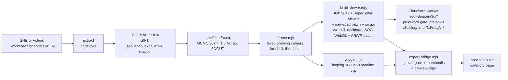

# gsplats: technical project description

End-to-end system that turns stills or videos from one or more cameras (designed around a rig of GoPro HERO12 bodies) into an interactive, web-hosted 3D Gaussian-splat scene at `https://<your domain>/3d/<slug>/`, and optionally hands each published scene to another website as a catalog entry with thumbnails and a preview clip.

This document describes the whole system: platform, software and builds, every processing stage, hosting, automation, measured performance and known gaps. The step-by-step guide is the root `README.md`; operational runbooks are linked at the end.

## 1. Summary

| | |
| --- | --- |
| Input | 300–800 stills (or videos) from 2–4 GoPro bodies walked around a subject; single-camera sets of up to ~1,400 stills also work |
| Output | Two builds per scene: a ~20 MiB compressed splat in a browser viewer at `/3d/<slug>/`, public or password-protected, with link previews; and a ~5 MiB decimated `/vr` build at `/3d/<slug>/vr/` for VR headsets and phone AR. Optionally a catalog (JSON, thumbnails, preview clips) for a host site |
| Core tech | COLMAP structure-from-motion → LichtFeld Studio 3DGS training (MCMC, 3DGUT for fisheye) → PlayCanvas SOG compression → SuperSplat web viewer → Cloudflare Worker |
| Runs on | One Windows workstation with an NVIDIA GPU, plus Cloudflare's edge |
| Time, drop to live | about 1.5 h of unattended reconstruction for a 400-image Wide set on an RTX 6000 Ada, then a few minutes of framing, building and deploying |



## 2. Platform

### 2.1 Workstation

The measurements in this document come from this reference machine. Nothing in the code depends on it beyond needing an NVIDIA GPU that LichtFeld supports.

| Component | Reference value |
| --- | --- |
| OS | Windows 11 Pro |
| CPU | AMD Ryzen Threadripper PRO 7975WX, 32 cores / 64 threads |
| RAM | 128 GiB |
| GPU | NVIDIA RTX 6000 Ada Generation, SM 8.9, 48 GiB |
| Driver | 597.06 (CUDA driver API 13.2) |

Nothing depends on machine-wide Node, PowerShell 7 or COLMAP: they can be portable copies under `pipeline/tools/` (gitignored), which the scripts find by path. The only machine-wide installs needed are ffmpeg and, to build LichtFeld from source, the C++/CUDA toolchain.

### 2.2 Cloud

| Service | Use |
| --- | --- |
| Cloudflare Workers | One Worker on the routes `<domain>/3d/*` and `<domain>/3d` (or a `workers.dev` host) |
| Workers Static Assets | Viewer HTML/JS, `scene.sog`, preview images (25 MiB per-file limit) |
| Cloudflare Turnstile | Bot check on the password page of protected scenes |
| Worker secrets | One password per protected scene, the session-signing key, the Turnstile secret |

### 2.3 Code and configuration

The repository holds code and docs only. Everything specific to one deployment lives in a site folder (`site/`, gitignored; template in `site.example/`, override with `GSPLAT_SITE_DIR`): `wrangler.jsonc` (account, routes, site name, Turnstile site key) and `scenes.json` (the scene registry). The Worker imports the registry through a Wrangler module alias (`gsplat-scenes` → `site/scenes.json`), and `web-viewer/scripts/wrangler.mjs` runs every Wrangler command with that config and a project-local login. Scene data lives in `_workspace/` (gitignored; override with `GSPLAT_WORKSPACE`).

## 3. Software inventory

### 3.1 Runtime tools

| Component | Reference version | Role |
| --- | --- | --- |
| COLMAP | 4.2.0 CUDA (`be5e291`), official Windows release | Feature extraction, matching, sparse reconstruction, undistortion |
| LichtFeld Studio | v0.5.3 (`d8c50c6`), GPL-3.0, built from source (section 4) | 3D Gaussian-splat training (headless), MCP automation server, viewer |
| PowerShell | 7.6 | Runs the pipeline scripts |
| Node.js | 24.21 | Web-viewer scripts, Wrangler |
| ffmpeg / ffprobe | 8.1 | Video frame sampling, contact sheets, JPEG/WebP encoding, video checks |
| NVIDIA `nvidia-smi` | with driver | GPU and VRAM telemetry |

### 3.2 Web libraries (pinned in `web-viewer/package.json`, pnpm lockfile)

| Package | Version | Role |
| --- | --- | --- |
| `@playcanvas/splat-transform` | 3.4.0 | PLY → SOG conversion (GPU k-means SH compression), transforms, headless GPU rasterizer for thumbnails and contact sheets |
| `@playcanvas/supersplat-viewer` | 1.31.1 | The browser viewer (WebGPU with WebGL fallback), patched at build time |
| `playcanvas` | 2.22.0 | Engine under both of the above |
| `wrangler` | 4.130.0 | Cloudflare deploy, secrets, local dev server |
| `@cloudflare/workers-types` | ^5.20260908 | Worker typings |

### 3.3 Build toolchain (for LichtFeld only)

| Component | Version |
| --- | --- |
| Visual Studio 2022 Build Tools | 17.14 (MSVC 14.44 and clang-cl) |
| CUDA Toolkit | 12.8 (toolkit only; the newer host driver is kept) |
| CMake | 4.x |
| Ninja | 1.13 |
| vcpkg | cloned to `pipeline/tools/vcpkg`, about 90 ports |
| Windows setting | `LongPathsEnabled=1` |

`pipeline/tools/installers/install-toolchain.ps1` installs the toolchain; no cuDNN is needed.

## 4. LichtFeld Studio

**Requirement.** LichtFeld Studio is the trainer, and the pipeline needs it installed or built. Any version from 0.4 trains (MCMC, 3DGUT). The 0.5 line adds an MCP (Model Context Protocol) HTTP server that the optional export and orbit stages talk to. At the time of writing, 0.5.x Windows binaries were distributed through the project's paid portal and v0.4.2 was the last free Windows zip, so the reference setup builds 0.5.3 from source.

**Source build** (`pipeline/tools/installers/build-lichtfeld.ps1`, mirrors upstream `.github/workflows/nightly.yml`, build-windows job):

```powershell
cmake -B build -S . -G Ninja -DCMAKE_BUILD_TYPE=Release -DBUILD_PORTABLE=ON -DBUILD_PYTHON_STUBS=OFF
cmake --build build
cmake --install build --prefix pipeline/tools/lichtfeld
```

- The script clones the tagged source (default `v0.5.3`, submodules included) to `pipeline/tools/lichtfeld-src` and vcpkg to `pipeline/tools/vcpkg` when they are missing.
- First configure about 50 minutes (vcpkg builds about 90 dependency ports); compile about 20 minutes on 64 threads. `-Reconfigure` wipes the build folder.
- Output: `pipeline/tools/lichtfeld/bin/LichtFeld-Studio.exe`, portable layout, about 550 MB with bundled DLLs. Kernels ship as PTX and JIT-compile for the local GPU on first launch.
- Gotchas handled by the script: `vcvars64.bat` needs the Visual Studio Installer folder on `PATH` to find `vswhere`; long paths must be enabled for vcpkg.
- Verified: `--version` reports v0.5.3; `--help` exposes `--headless --train --strategy --max-cap --iter --gut`; the MCP server listens on `127.0.0.1:45677` in GUI mode.

**Discovery.** `run.ps1` and `reconstruct.ps1` take LichtFeld from `-LichtFeldPath`, else `LICHTFELD_PATH`, else PATH, else `pipeline/tools/lichtfeld/`. COLMAP follows the same pattern (`COLMAP_PATH`, PATH, `pipeline/tools/colmap*/`).

## 5. Capture

- **Rig:** 2–4 GoPro HERO12 Black bodies, walked around the subject at roughly eye height, stills at interval (or video sampled later). A single mirrorless camera works too.
- **Lens mode:** Wide is preferred. It keeps the full ~120° field and the least-processed pixels, and trains natively through 3DGUT. Linear, Narrow and Linear+Horizon-Lock are supported through COLMAP undistortion. SuperView and HyperView are rejected: they are non-physical horizontal stretches that no camera model fits. The mode is not recorded anywhere in GoPro EXIF, so it is declared (section 6.1).
- **Coverage:** 300–800 frames total for a multi-camera set. More adds COLMAP time superlinearly for little gain. No automatic blur rejection; drop soft frames by hand.
- **Folder rule:** one folder per physical body (`cam1`, `cam2`, …). COLMAP assigns one intrinsics set per folder, so merged folders get wrong intrinsics. Folders from different bodies that were merged can be split by the EXIF serial number. Stills edited in other software lose the GoPro MakerNote and must have their lens given explicitly.

## 6. Reconstruction pipeline (`pipeline/`)

### 6.1 Orchestration: `reconstruct.cmd` → `reconstruct.ps1` → `run.ps1`

`reconstruct.cmd <scene folder>` is the one-shot entry point. It:

1. **Resolves the lens**, first match wins: `-Lens` flag; a `_wide`/`-wide`/`_linear`/`-linear` token in the folder name; `capture.json` from an earlier run; a provisional GoPro MakerNote fingerprint (two header bytes that differed between Linear and Wide shoots, used only as a last resort, always with a warning). If none applies, it stops and asks.
2. **Plans** the run: image count, sub-stage estimates from `pipeline/timings.json` (seeded with rates measured on the reference machine and re-learned after every completed sub-stage by averaging), and the exact `run.ps1` command lines. `-DryRun` stops here.
3. **Runs** `extract`, `sfm` and `train` through `run.ps1` in PowerShell 7, printing a status line every 15 s: sub-stage, elapsed, estimated time left, estimated completion. Training progress is read live from LichtFeld's progress output; COLMAP sub-stages are estimated from rates.
4. **Records** a run id (`yyyyMMdd-HHmmss`), a timestamped `runs/<id>/reconstruct.log`, and at the end calls `stats.ps1` (section 6.6).

`run.ps1` is the stage engine. Its contract:

- Stages `extract | sfm | train | export | orbit | all`; each checks for its own output and skips unless `-Force`.
- Every command line, its output and each stage result go to `<scene>/log.txt`. Any failure stops the run with exit code 1.
- The resolved lens is written back to `<scene>/capture.json`. A command-line value that disagrees with it fails without `-Force`. Before training, the script decodes `colmap/sparse/0/cameras.bin` and refuses to train if the camera model on disk disagrees with the declared lens.
- Tool flags are discovered, not assumed: COLMAP option names are read from `-h` (3.x `SiftExtraction` vs 4.x `FeatureExtraction`), and LichtFeld's `--help` is saved to `lfs/flags.txt` and checked before any flag is used.
- All deletes go through `Assert-SafeChild` and are confined to the scene folder.
- `tests/smoke.ps1` checks the parameter contract, the lens table, the `cameras.bin` reader, tool discovery and lens resolution end to end, with no GPU or external tools.

### 6.2 Extract

Stills are hard-linked (copied if linking fails) into `images/<cam>/`; videos are sampled with ffmpeg at 3 fps into quality-2 JPEGs, or, with `-SharpestOf N` (handheld phone video, see `pipeline/docs/PHONE_VIDEO.md`), `select-frames.ps1` keeps the sharpest frame of every N. Fails below 20 images. A marker file `extract.complete.json` records the result, outside `images/` so COLMAP never reads it.

### 6.3 Structure from motion (COLMAP CUDA)

```text
feature_extractor   camera_model OPENCV (Linear) | OPENCV_FISHEYE (Wide), single_camera_per_folder 1, GPU SIFT
sequential_matcher  overlap 20, loop detection, GPU
mapper              → colmap/sparse/0
model_analyzer      → colmap/sfm.metrics.json
```

Success means exactly one model. Anything else wipes `sparse/` and retries with `exhaustive_matcher`. A directory junction `colmap/images → ../images` lets LichtFeld find images beside the model. Past about 1,000 images the incremental mapper slows badly; COLMAP's `global_mapper`, run by hand, registered a 1,383-image set in about an hour.

### 6.4 Training (LichtFeld Studio, headless)

```powershell
LichtFeld-Studio.exe --headless --train -d <dataset> -o <scene>\lfs --strategy mcmc --max-cap 1500000 --iter 30000 [--gut] [--mask-mode ignore]
```

- **Linear sets:** `colmap image_undistorter --max_image_size 3840` writes a pinhole dataset; plain rasterizer.
- **Wide sets:** train on the fisheye COLMAP model directly with `--gut` (3DGUT, 3D Gaussian Unscented Transform), which projects each Gaussian through the real lens model, so nothing is cropped or resampled.
- MCMC densification up to a 1.5 M Gaussian cap, 30,000 iterations. Output `lfs/splat_30000.ply`: 1.5 M splats × 62 float properties (position, scale, rotation, opacity, degree-3 spherical harmonics) = 355 MiB.
- `-MaskMode` passes per-image masks (`<dataset>/masks/<cam>/<stem>.png`) for scenes with transient content such as passers-by.
- The script requires a checkpoint to exist, parses the final loss, polls `nvidia-smi` for VRAM, and writes `lfs/training.metrics.json`.

### 6.5 Export and orbit (LichtFeld MCP), optional

Implemented, but not part of the web path and not yet exercised against a finished scene. With LichtFeld v0.5+ running in GUI mode, `run.ps1` connects to `http://127.0.0.1:45677/mcp`, lists tools and resources (saved to `lfs/mcp-catalog.json`), and calls only tools whose schemas exist in that build. `export` writes `lfs/<scene>.ply` and `.spz`. `orbit` plans a 24-keyframe circle (radius 2.5× the scene bounds, eye 0.25 radius above center), pushes it to the sequencer and renders a 3840×2160, 30 fps, 10 s MP4. It then verifies the video with ffprobe/ffmpeg: resolution, duration within 5%, and no black frames at the start, middle or end.

### 6.6 Run metrics (`stats.ps1`)

After every run, `stats.ps1` harvests metrics from what the stages already wrote, so collection never slows a run. Its sources: `log.txt` timings, COLMAP output, `sfm.metrics.json`, the LichtFeld log and metrics, and the PLY header. It writes `runs/<id>/stats.json` and `stats.md` and appends a row to `pipeline/runs.jsonl`. The metrics cover input size and resolution; per-sub-step wall time and s/image; SIFT features and verified pairs; registration, 3D points, track length and reprojection error; iterations/s, loss at milestones, the iteration where the splat cap was reached and image-loader hit rate; PLY size, bytes per splat, and GPU/CPU/RAM. `stats.ps1 -Table` compares runs; `stats.ps1 <scene>` backfills older scenes.

## 7. Web pipeline (`web-viewer/`)

### 7.1 Framing: `scripts/frame.mjs`

Trained splats come out in COLMAP's arbitrary frame, tilted, with the subject off-center. Framing fixes that in two passes.

**Pass 1, measure and propose**

- **Gravity:** "up" is the mean of all camera up-vectors from `images.bin`, cross-checked against the normal of the plane through the camera centers, which a level walk-around should be perpendicular to. Frames where the rig was rolled sideways are left out: a camera's right-vector stays horizontal at any pitch, so its angle to the estimate is the roll, and frames past `--max-roll` (default 20°) are dropped and the mean recomputed until stable. A level capture drops nothing; on a set where the rig was tipped 45–60° three times, it dropped 40 of 407 frames, a 1.5° correction. The dropped names go in `frame.json` as `rolledFrames`.
- **Levelling:** the script derives the rotation that levels the scene, as PlayCanvas-convention Euler angles, round-trip-verified to 1e-6.
- **Subject center:** taken from opaque splats (opacity above 0.5) inside the camera ring. The height is lifted from the ground median toward camera height (`--lift`, default 0.45).
- **Candidate views:** "azimuth 0" is the direction toward the mean camera position, i.e. the side the photographer favoured, usually the front. The script renders a contact sheet of 8 azimuths plus a top view, using splat-transform's headless GPU rasterizer on a degree-1 preview.

**Choose.** A person or a vision model picks the azimuth (and optionally elevation, distance, FOV) from the sheet.

**Pass 2, finalize**

- **Opening camera:** written to `frame.json`, which becomes the viewer's initial camera.
- **Far shell:** writes `frame/publish.ply` with the rotation baked in and every splat farther than about 300 capture radii pulled onto a thin shell along its own ray, its scale adjusted to cover the same solid angle. Outdoor scenes put sky splats up to 10⁶ units out. The viewer's GPU sort spreads fixed-bit depth keys over the whole range, which left subjects unsorted: translucent bodies and smeared ground. The shell keeps the horizon looking identical and restores sort precision.
- **Thumbnail:** renders `<scene>/thumbnail.jpg` (via `scripts/thumbnail.mjs`), a 1920×1280 (3:2) rectilinear view from the opening camera, rendered at 3840×2560 and Lanczos-downsampled to supersample away single-sample splat aliasing.

### 7.2 Build: `scripts/build-viewer.mjs`

1. **Compress:** convert `publish.ply` to **SOG** with splat-transform on the GPU. SOG packs positions, rotations, scales and colours into quantized WebP textures with k-means-clustered spherical harmonics. 355 MiB becomes 20–22 MiB, a 94% reduction, under Cloudflare's 25 MiB per-file limit.
2. **Viewer page:** render the SuperSplat viewer HTML with the opening camera from `frame.json`, a dark background and `noindex` meta.
3. **Patch the viewer:** copy the viewer bundle through `viewer-patch.mjs` (section 7.3).
4. **Preview image:** write `og.jpg` (1200×800, quality-stepped until it is under 300 KB, because WhatsApp drops larger preview images) and `social.json`, which records its content hash so the image URL changes when the thumbnail does.

Output: `dist/3d/<slug>/{index.html, index.js, scene.sog, og.jpg, social.json, build.json}`.

5. **The `/vr` variant:** the same run then writes `dist/3d/<slug>/vr/`, a second, reduced copy of the scene for headsets and phone AR. The full 1.5 M splat scenes are not usable in a Quest 3 browser or a phone AR session: every frame is rendered twice at headset resolution and, on the WebGL path an XR session needs, the splats are sorted on the CPU. Published guidance puts standalone Quest 3 at a few hundred thousand splats (PlayCanvas budgets 1 M for mobile with LOD streaming, GSVision recommends 700 k and lags at 1.2 M, Meta's native Spatial SDK says 150 k). The pipeline, all through splat-transform:
   1. **Opacity cull** (optional): drop splats with opacity at or below `minOpacity` (default 0.05; about 28% of a typical scene's count and about 1% of its alpha-weighted screen coverage). 0 disables it.
   2. **Decimate** on the CPU to `splats`, forced even: `--decimate` (uniform, the default) or `--decimate-adaptive` (error-driven merging that keeps the subject's detail but also nearly all its overlapping layers). The decimated PLY is kept next to `publish.ply` as `vr_<slug>.ply` so a build can be checked with the CLI renderer without a headset.
   3. **SOG** with spherical harmonics cut to `sh` bands (default 1).
   4. **Page and patch:** the `/vr` page always starts on WebGL: WebXR sessions cannot run on the viewer's WebGPU device (no `XRGPUBinding` in Quest's browser, nor in Chrome on Android). `index.js` is the bundle patched with `xr: true` and the XR levers below.

   | Key (`vr` in `scenes.json`) | Flag | Default | Meaning |
   | --- | --- | --- | --- |
   | `splats` | `--vr-splats N` | 350000 | Target splat count, forced even, at least 10,000 |
   | `sh` | `--vr-sh 0..3` | 1 | Spherical-harmonic bands kept |
   | `minOpacity` | `--vr-min-opacity a` | 0.05 | Opacity cull threshold, in [0, 1); 0 disables |
   | `decimate` | `--vr-decimate adaptive\|uniform` | uniform | Decimation mode |
   | `xrFramebufferScale` | `--vr-framebuffer-scale s` | 0.7 | XR framebuffer scale, in (0, 1]; 0.7 is 51% fewer pixels per eye |
   | `xrFarClip` | `--vr-far-clip d` | 4000 | XR far clip in scene units, at least 1000 |
   | `xrFixedFoveation` | `--vr-foveation f` | 0.5 | WebXR fixed foveation 0..1; level 1 showed a coarse patch at the nasal edge of the left eye on Quest 3 |
   | `xrFrameRate` | `--vr-frame-rate hz` | 72 | Session frame rate requested when the headset offers it |
   | `xrSortEpsilon` | `--vr-sort-epsilon e` | 0.01 | Camera movement below which the WebGL sorter does not re-sort |

   Precedence is defaults, then the scene's `vr` block, then command-line flags. Every effective value is recorded in `vr/build.json`.

Note on splat-transform 3.4.0: its GPU SOG writer crashes silently (`STATUS_STACK_BUFFER_OVERRUN`, `0xC0000409`) on odd splat counts, and its GPU-initialised decimation pass crashes the same way on some inputs. The builder therefore decimates with `--gpu cpu` and forces every target count even before the GPU SOG step.

### 7.3 Viewer patch: `scripts/viewer-patch.mjs`

The stock SuperSplat gamepad handling turns at about 9°/s with a linear stick and no dead zone. The patch replaces the viewer's `GamepadDevice` class with FPS-style control: 126°/s yaw and 95°/s pitch at full deflection (FOV-scaled, with Halo-style look acceleration), a 12% radial dead zone and a 1.5-power response curve, sprint on L3 or RT, precision on LT, fly up and down on RB/LB, jump on A. It also injects an "Invert Y-Axis" switch into the viewer's settings panel.

**Orbit by default.** Every device starts in Orbit around the opening camera's target: drag orbits the subject, two fingers or right-drag pan, pinch or wheel zooms. (The stock viewer picks Orbit only when the opening camera is outside the scene bounds, which never holds once the far shell is in place.) **Keyboard look:** I/J/K/L turn the view like a digital right stick at 0.6× the gamepad rates, with eased starts and stops, so W/A/S/D + Q/E and I/J/K/L fly two-handed.

**AR/VR.** The main build forces `state.hasAR` and `state.hasVR` false, so the buttons never appear on the full scene. The `/vr` build keeps them and tunes the session with the levers in section 7.2. Quest's browser identifies as Linux rather than Android, so both builds also turn Performance Mode on by default for an `OculusBrowser`/`Quest` user agent.

The patch is anchored on exact code shapes. It refuses to run if a viewer upgrade changes them, so a layout change fails the build instead of silently shipping stock behaviour. `node scripts/viewer-patch.mjs` re-patches every built scene from the pristine bundle without reconverting, reading each `/vr` build's XR values back from `vr/build.json`.

### 7.4 Hosting: Cloudflare Worker (`src/index.js`, `site/scenes.json`, `site/wrangler.jsonc`)

The Worker runs before every static asset (`run_worker_first`), so nothing under `/3d/` is served without passing its checks.

- **Registry:** `site/scenes.json` holds per slug: title, description, capture date, source folder, `passwordBinding`, `unlisted`, and optionally `socialImage`, `thumbnailFocus`, `location` (hand-entered; protected scenes never export coordinates) and `vr` (build overrides). Only registered slugs are served. Everything else under `/3d/` is a 404, including slugs that match inherited object properties.
- **Site settings** come from Worker vars: `SITE_NAME` (link previews, login page brand), `SITE_URL`, `GSPLAT_INDEX_URL`, `TURNSTILE_SITE_KEY`, `TURNSTILE_EXPECTED_HOSTNAME`, `SESSION_TTL_SECONDS`.
- **The `/vr` variant:** `/3d/<slug>/vr/` is a subpath of the scene, so the same password gate, session cookie and headers cover it. It is not listed anywhere.
- **Protected scenes:**
  - The viewer page and every asset redirect to `/3d/<slug>/login`.
  - That page runs a Turnstile challenge, verified server-side for success, action `gsplat_login` and the expected host name.
  - The password is checked against that scene's Worker secret with SHA-256 digests and `timingSafeEqual`.
  - Success sets a `__Host-` cookie scoped to the scene: HMAC-SHA-256 signed, `HttpOnly`, `Secure`, `SameSite=Lax`, valid 24 h by default.
- **Routing:** `/3d` and `/3d/` get a 302 to `GSPLAT_INDEX_URL` when set (the Worker never lists scenes itself). Any `http://` request under `/3d` gets a 308 to `https://`, because a zone may not force HTTPS and the session cookie is `Secure`.
- **Link previews:** an `HTMLRewriter` injects Open Graph and Twitter-card tags into the viewer and login pages and sets the page title from the registry. Public scenes expose `og.jpg` without a session, cached publicly, with a content hash in the URL (`?v=`). Protected scenes preview as text only.
- **Headers:** `X-Robots-Tag: noindex, nofollow, noarchive, nosnippet`, `X-Frame-Options: DENY`, `Referrer-Policy: no-referrer`, and `nosniff` everywhere. The login page also sends a strict CSP.

### 7.5 Deploy

`wrangler deploy` (through `scripts/wrangler.mjs`) uploads the Worker and all of `dist/` (only changed assets are sent), with auth pinned to the project's `.wrangler-config` profile. Every deploy prints a version id; `wrangler rollback <id>` reverts. Passwords go in only through Wrangler's masked `secret put` prompt.

### 7.6 Catalog export for a host site: `scripts/export-bridge.mjs`, optional

For a separate website (blog, portfolio, media library) that should list the scenes, the export writes to a folder that site's build reads:

- **`gsplats.json`:** one item per scene: slug, URL, title, description, date, `location` (coordinates only for public scenes with exact precision), `protected`, `unlisted`, scene size and splat count, a `revision` hash for change detection, and a thumbnail block.
- **`gsplats.schema.json`:** a JSON Schema for the catalog.
- **`thumbnails/<slug>/`:** `master.jpg` plus WebP crops at 3:2, 16:9, 21:10 and 1:1, centered on a per-scene focal point.
- **`previews/<slug>.mp4`:** the wiggle clip from section 7.7, when the scene has one.
- **`HANDOFF.md`:** the integration guide, from `web-viewer/CATALOG.md` or the site folder's own `HANDOFF.md`.

It validates the registry and every file before writing, writes the catalog atomically, re-encodes only changed thumbnails, copies a clip only when its hash changed, and removes thumbnails and clips of scenes that have left the registry.

### 7.7 Landing-page preview clip: `scripts/wiggle.mjs`

A still thumbnail undersells a splat, so each scene can have a short looping clip with visible motion parallax. `wiggle.mjs` starts at the opening camera and moves it once around a small tilted ellipse while it keeps looking at the same target: sideways, up and down and toward and away, with half-amplitudes of 7, 3.5 and 3 percent of the camera distance. One full ellipse per clip means the video loops without a cut. Output: 1920×1080, 30 fps, 6 s, H.264 yuv420p with faststart, no audio, 2–5 MB.

It renders in-process with splat-transform's headless GPU rasterizer (loaded through the library API rather than the CLI, which would reload the 355 MiB PLY per frame). The rasterizer still re-uploads and re-sorts every splat per frame, so the fixed cost dominates: 2.5 s a frame for 1.5 M splats against 1.8 s for 500 k. The script therefore decimates `publish.ply` once to a cached 500 k `wiggle_source.ply` and renders 180 frames in about 6 minutes.

## 8. Automation: files in → public scene

| # | Step | Command | Who | Typical time |
| --- | --- | --- | --- | --- |
| 1 | Copy captures to `_workspace\<date>_<subject>_wide\cam1..N` | Explorer | person | minutes |
| 2 | Extract, SfM, train | `pipeline\reconstruct.cmd <folder>` | **automatic** (lens from the folder-name token) | 1.5–2 h for 400–540 Wide images |
| 3 | Level, propose views | `node scripts\frame.mjs <scene>` | **automatic** | about 1 min |
| 4 | Pick the "front" | read `frame\contact.png` | person, or a vision model | seconds |
| 5 | Finalize framing and thumbnail | `node scripts\frame.mjs <scene> --azimuth N …` | **automatic** | about 1 min |
| 6 | Build the web scene (full and `/vr`) | `node scripts\build-viewer.mjs <ply> <slug>` | **automatic** | about 15 s, plus about 35 s for `/vr` |
| 7 | Register title, description, access, listing | edit `site\scenes.json` | person (editorial decisions) | minutes |
| 8 | Set a password (protected scenes only) | `pnpm run password:set -- <slug>` | person (masked prompt, never scripted) | seconds |
| 9 | Deploy | `pnpm run deploy` | **automatic** | about 20 s |
| 10 | Render the landing-page clip (optional) | `node scripts\wiggle.mjs <scene>` | **automatic** | about 6 min |
| 11 | Update the host-site catalog (optional) | `node scripts\export-bridge.mjs <folder>` | **automatic** | about 15 s |

Each automatic step is idempotent and fails loudly. In practice a capture dropped into a folder named `…_wide` becomes a live scene with one reconstruct command, one framing decision, one registry entry and one deploy.

**What remains manual, and why:**

- **The lens declaration.** GoPro files do not record the lens mode. A folder-name token makes this free.
- **The "front".** This is an editorial choice. A coding agent or one vision-API call can read the contact sheet and return an azimuth.
- **Metadata and access.** Title, description, public vs password and listed vs unlisted are publishing decisions. The export refuses scenes without them, so nothing is listed by accident.
- **Passwords.** These are deliberately never passed on a command line or through a script.

## 9. Measured results

Reference machine (section 2.1), MCMC, 1.5 M cap, 30k iterations unless noted:

| Scene | Lens | Images / cams | Registered | Sparse points | Reproj. (px) | SfM s/img | Train it/s | Final loss | Total |
| --- | --- | --- | --- | --- | --- | --- | --- | --- | --- |
| Car in a garage | Linear | 545 / 3 | 100% | 236,647 | 1.31 | – | 22.1 | 0.04 | 0:23 (train) |
| Person in an outdoor maze | Wide | 410 / 3 | 100% | 255,639 | 1.21 | 4.47 | 8.2 | 0.04 | 1:32 |
| Person under a roadside sign | Wide | 407 / 4 | 100% | 213,291 | 1.19 | 3.86 | 8.1 | 0.06 | 1:28 |
| House front lawn | Wide | 394 / 4 | 100% | 179,246 | 1.49 | 6.81 | 11.8 | 0.08 | 1:27 |
| Hillside trail 1 | Wide | 538 / 4 | 76% | 154,902 | 1.34 | 2.65 | 7.8 | 0.10 | 1:28 |
| Hillside trail 2 | Wide | 393 / 4 | 75% | 151,477 | 1.21 | 2.61 | 7.2 | 0.05 | 1:27 |
| Car in a workshop (mirrorless, 60k it.) | Pinhole | 1,383 / 1 | 100% | 441,697 | 1.22 | 3.66 (global mapper) | 24.8 | 0.03 | 1:24 SfM + 0:43 train |

Observations:

- **Training dominates.** On the maze run, SfM took 31 min (mostly the COLMAP mapper, 24 min) and training took 61 min. The splat cap was reached by iteration 4,300 (6 min in); the rest is refinement at a constant 1.5 M splats.
- **Wide/3DGUT trains 2.7× slower per iteration than the Linear/pinhole set** (8.2 vs 22.1 it/s). This mixes two effects: 3DGUT's per-Gaussian unscented projection, and full-resolution 27 MP fisheye frames versus undistorted frames capped at 3840 px. Wide vs Linear on the same subject is still unmeasured.
- **The hillside sets registered about 75%:** one camera's video frames did not register.
- **Sizes, per scene:** 1.6–2.4 GB of stills in, a 355 MiB PLY, 20–22 MiB on the wire, a 140–270 KB preview image.

**The `/vr` builds:**

- **Size and time.** A 350 k uniform SOG at SH band 1 is 5–6 MiB. The variant adds about 35 s per scene, mostly CPU decimation.
- **Overdraw** (estimated layers per pixel for an eye 2 m from a group of three people on a hillside):

  | Build | Splats | Layers per pixel |
  | --- | --- | --- |
  | Full scene | 1.5 M | 223 |
  | Adaptive | 500 k | 165 |
  | Adaptive | 400 k | 159 |
  | Uniform | 400 k | 115 |

  Adaptive decimation keeps the near subject almost as dense as the full scene; only uniform decimation brings the overdraw over the subject down.
- **Opacity cull.** Thresholds above 0.1 are not usable: at 0.2 dry grass turns streaky and dark.
- **In the headset (Quest 3, WebGL).** Adaptive 500 k at framebuffer 0.8 stuttered when looking at the subject. Uniform 400 k at framebuffer 0.7, 72 Hz had only minor stutter; uniform 350 k performs well, hence the defaults. Fixed foveation 1 showed a coarse patch at the nasal edge of the left eye, gone at 0; 0.5 is the default.

## 10. Data and repository layout

```text
gsplats/                         code and docs only
  README.md  PROJECT.md
  pipeline/                      reconstruct.cmd/.ps1, run.ps1, stats.ps1, docs/, tests/
    tools/                       your tool installs (gitignored except INSTALLS.md and installers/)
  web-viewer/
    src/index.js                 the Worker
    scripts/                     frame, thumbnail, build-viewer, social, viewer-patch, wiggle, export-bridge, wrangler, site
    dist/3d/<slug>/              built scenes (gitignored, deployed)
    README.md  PUBLISHING.md  CATALOG.md
  site.example/                  template for site/
  site/                          your wrangler.jsonc and scenes.json (gitignored)
  _workspace/                    all scene data (gitignored)
    <scene>/ cam*/ images/ colmap/ lfs/ frame/ runs/ thumbnail.jpg capture.json log.txt
```

Git holds no captures, models, renders, site configuration or per-run history (`runs.jsonl` and `timings.json` stay local). Bulk formats (`*.ply`, `*.spz`, `*.sog`, `*.jpg`, `*.mp4`) are ignored everywhere.

## 11. Security and privacy

- **The Worker is the only access boundary.** It enforces the registry, passwords, sessions and the http→https upgrade. `noindex` headers are discovery hints, not protection.
- **Protected scenes:** the model, viewer code and preview image all require the scene's session; link previews show no image; the catalog marks the scene `protected` and never exports its coordinates.
- **Secrets:** passwords, the session key and the Turnstile secret exist only as Worker secrets, entered through masked prompts. The Wrangler OAuth profile is project-local.
- **Deliberately not done:** no HSTS from the Worker, since HSTS would apply to the whole host. No iframe embedding (`X-Frame-Options: DENY`).

## 12. Known gaps and open items

- **Windows only.** The reconstruction scripts use PowerShell 7, NTFS hard links and junctions, and `.exe` tool names.
- **Export and orbit never exercised.** The MCP stages have not run against a finished scene; their tool names are validated against the live catalog at run time.
- **Peak VRAM reads 0.** `nvidia-smi` does not attribute memory to the LichtFeld process.
- **No blur rejection.** Soft frames are removed by hand.
- **The front is chosen by hand.** The pass-1 subject center can land in tree canopy on wooded scenes, and cramped sites can put the camera behind structures.
- **25 MiB asset limit.** A larger SOG needs a lower `-MaxCap` or R2 storage streamed through the Worker.
- **`/3d/` is the fixed path prefix.** The Worker, builder and catalog all assume it.
- **Wide vs Linear on the same subject is unmeasured.**
- **`/vr` runs on WebGL with the CPU sorter**, so splat count matters there over and above overdraw. Streamed SOG with LOD was considered and rejected: it thins by chunk distance and leaves the near subject at full density, which is exactly where the headset stutters.
- **No in-headset frame-rate telemetry.** The `/vr` levers are tuned by feel, per scene.

## 13. Document index

| Document | Covers |
| --- | --- |
| `README.md` | Requirements and the step-by-step guide: capture to live URL |
| `pipeline/README.md` | Reconstruction entry points and run statistics |
| `pipeline/docs/PIPELINE.md` | Stage reference: command shapes, MCP contract, acceptance checks |
| `pipeline/docs/LENS_MODES.md` | GoPro lens modes, fisheye support, lens declaration |
| `pipeline/tools/INSTALLS.md` | Installing the tools; building LichtFeld from source |
| `web-viewer/README.md` | Viewer build, password gate, gamepad behaviour |
| `web-viewer/PUBLISHING.md` | Cloudflare setup and publishing runbook, secrets, rollback |
| `web-viewer/CATALOG.md` | Catalog contract for a host site (exported as `HANDOFF.md`) |
| `site.example/README.md` | The private site configuration |
